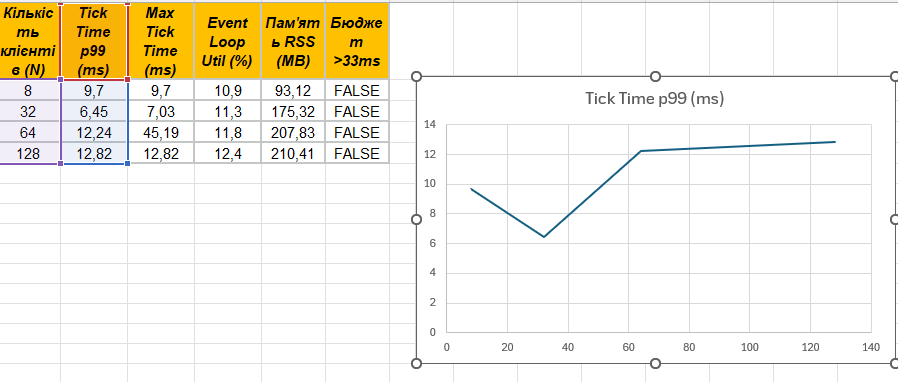

[](https://github.com/xenoner2303/jslab1/actions/workflows/ci.yml)

## Lab 4 — Bots, Web Worker and load test

### Add server-side bots
Start the server, create or choose a room with free slots (the room must have `maxPlayers` up to 8), then send:

```bash
curl -X POST http://localhost:3000/api/rooms/ROOM_ID/bots \
  -H "Content-Type: application/json" \
  -d '{"count":3}'
```

The endpoint adds 1–8 bots, limited by the room's remaining capacity. Bots use the same `ShipInputHandler` path as human players, pursue the nearest living ship, keep some distance, and fire when aimed at a target. They appear in snapshots and the room roster.

### Particle preparation Web Worker

`client/src/workers/particle.worker.ts` prepares explosion particle coordinates into transferable `Float32Array` buffers. `client/src/main.ts` sends explosion snapshot data to the worker and `client/src/render/draw.ts` uses the prepared buffer when it is ready (with a synchronous fallback). This moves particle render-data preparation off the main browser thread; it does not move authoritative game simulation.

### Load test

With the server running in one terminal, run from the project root:

```bash
npm run load-test
```

By default it tests 8, 32, 64 and 128 clients for 30 seconds per scenario. It creates enough rooms (8 clients per room), connects WebSocket clients, and sends input messages at 30 Hz. Optional environment variables: `LOAD_TEST_URL`, `LOAD_TEST_COUNTS` (comma-separated), `LOAD_TEST_DURATION_MS`, and `LOAD_TEST_RAMP_DELAY_MS`. The output includes connected clients, tick-time p99/max, event-loop utilization, RSS, and received downstream bytes per second. The 33 ms tick budget is reported as a boolean.

The `/api/stats` endpoint now includes `rssBytes` and `eventLoopUtilization` alongside per-room tick metrics.

## Load Test Results & Capacity Analysis
