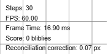
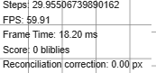

## 1. With a prediction error in the shared `integrate.js` physics, I added a random angle change. The ship had to keep correcting its direction.
```
angle += (Math.random() - 0.5) * 0.05; // only for the lab
```



## 2. Without random changes



As we can see, at the second one correction is near 0, because client and server prediction usually coincides

## M4 — JSON vs Binary measurements

Test at 30 Hz with 4 players. Measure each codec under the same game conditions.

| Codec | Bytes per snapshot | Down per client (KB/s) | Up per client (KB/s) | Encode + decode (µs) |
|---|---:|---:|---:|---:|
| JSON | — | — | — | — |
| Binary (`DataView`) | — | — | — | — |
