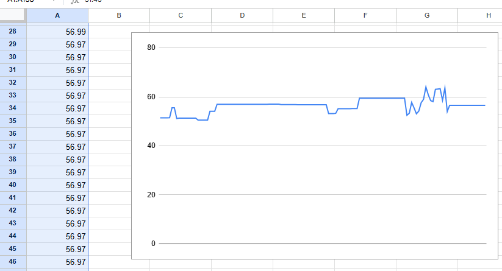

## M3: Replay backpressure check
Replay file: `server/logs/room1-test-200mb.ndjson`
Download URL: `http://localhost:3000/api/replays/room1-test-200mb`
DevTools network throttling: 3G
- RSS was printed once per second in the server console by temporary timer:
```
const rssMetricsInterval = setInterval(() => {
  const rssMemoryMB = process.memoryUsage().rss / 1024 / 1024;
  console.log(`Server RSS Memory: ${rssMemoryMB.toFixed(2)} MB`);
}, 1000);
```

Graphs of RSS memory usage during 2 mins backpressure test:


## M4: Abuse handling and the event loop
### Abuse limits
Each WebSocket gets a token bucket: 30 messages per second, with a burst of 30. Exceeding it closes the connection with code `4008`.
Message size is capped at 64 KiB; rooms allow up to 8 players, and the server allows up to 100 rooms.
If a client's outgoing buffer exceeds 256 KiB, its non-critical `state` updates are skipped. Chat and roster messages are kept.

### Event-loop blocking demonstration
Node runs JavaScript on one thread. The event loop moves through timers, pending callbacks, poll (I/O), check (`setImmediate`), and close callbacks; promise and `process.nextTick` callbacks run between phases.

`GET /api/slow` blocks that thread for 3000 ms (need for demosntration):
```text
http://localhost:3000/api/slow
```

### Backpressure
When a writable is slower than its readable, backpressure slows the producer instead of letting buffered data grow without limit. In M3, `pipeline(readStream, res)` streams the throttled 200 MB replay; the graph above shows server RSS during download.

### Errors and rejected promises
An `EventEmitter` with no `"error"` listener throws and can bring down the process:
```text
Error: boom
    at ...
Emitted 'error' event on EventEmitter instance ...
```

As a solution we need just to attach a listener:
```js
emitter.on("error", (error) => {
  console.error("Emitter failed:", error);
});
```

An unhandled rejection can also stop the process:
```text
Error: boom
    at ...
```

As a solution we can catch it where the async work is started:
```
doWork().catch((error) => {
  console.error("Work failed:", error);
});
```

The server already handles socket errors and logs match-log pipeline failures.
