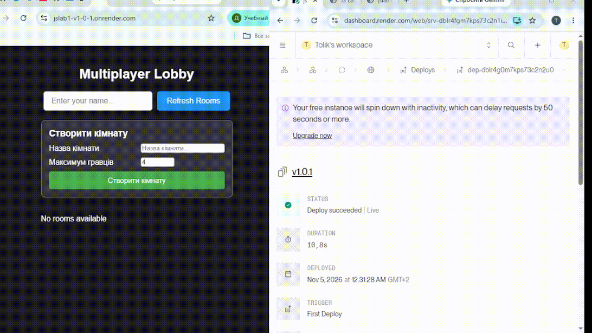
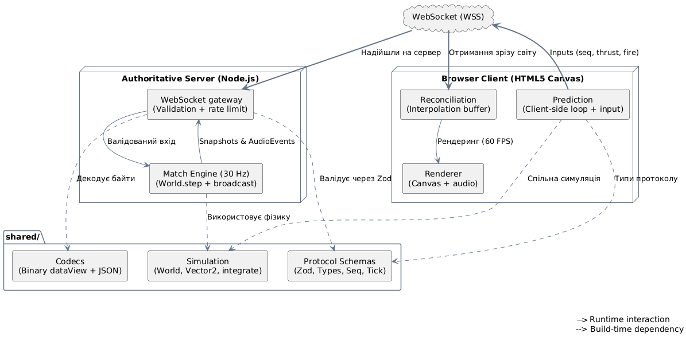
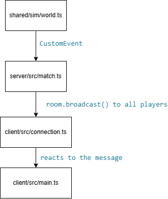

# Node.js CosmoBliBliekills Game Server

A real-time multiplayer WebSocket game server built with Node.js, TypeScript, Zod, and HTML5 Canvas.

**Live Demo:** [https://jslab1-v1-0-1.onrender.com](https://jslab1-v1-0-1.onrender.com)

---

## Gameplay

Real-world match recording featuring independent players across distinct networks:

---

## Architecture

### World event flow

**Protocol** - all incoming and outgoing messages are validated at runtime using `Zod` discriminated unions (`MessageSchema`, `ServerMessageSchema`).

**JSON + Binary measurements**

High-frequency game states (snapshots and player inputs) are optimized to reduce serialization overhead.
Test at 30 Hz with 4 players. Measure each codec under the same game conditions.

| Codec | Bytes/snapshot | KB/s per client (down) | KB/s per client (up) | Encode+ decode µs |
|---|---:|---:|---:|---:|
| JSON | 3676 | 107.4 | 2.04 | 88.3 |
| Binary (`DataView`) | 575 | 16.8 | 0.38 | 74.5 |

As far as we can see, binary sends less data, but its format is harder to read and maintain.

---

## Consolidated Measurements + Lab Metrics

### Container
**Base Image:** `node:22-alpine` (multi-stage build separating builder and runtime environments)
**Security:** runs under a non-root `node` user with explicit health checks

| Image Tag | Disk Usage | Content Size |
| :--- | :---: | :---: |
| `ghcr.io/xenoner2303/jslab1:v1.0.1` | 286 MB | 71.9 MB |

### Network Profile
Sample captured during an active multi-client session via `/metrics`:
1) **Tick P99 Latency (`game_tick_duration_p99_ms`):** < 2.5ms (maintains rock-solid 60 FPS / 16.6ms budget)
2) **Memory Footprint (`process_rss_bytes`):** ~89 MB RAM

### Real-World RTT Measurements
Measured between independent peers across different ISP networks:
1) **Peer A (Host / Render Region EU):** ~32 ms RTT
2) **Peer B (External Network):** ~65 – 85 ms RTT

---

## Security + Hardening

1) Handshake checks enforce `ALLOWED_ORIGINS` to prevent Cross-Site WebSocket Hijacking (CSWSH)
2) Rate Limiting & Abuse Protection:
  * Per-IP connection caps
  * Strict payload size restrictions and 5-second join timeouts
  * Flooding the socket with invalid frames (e.g., 1,000 bad frames/sec) triggers immediate connection termination, updates Prometheus counters (`game_rejections_total`), and has zero impact on other active rooms' tick performance
3) Realised graceful shutdown: intercepts `SIGTERM` / `SIGINT`, broadcasts code `1001` with a farewell message to active sockets, drains connections, and exits cleanly with code `0` within 5 seconds

## Known Limitations
1) Game state is currently held entirely in memory and, as it scales in the future, it may require significant resources
2. On the free Render tier, instances spin down after inactivity, leading to a ~30-second initial connection delay
3. Client-side interpolation relies on basic dead reckoning without advanced lag compensation
4. Homing is a single constant modifier of all MiniRockets at this version (1.0.1)

---

## What I'd Do Next
1) Add persistent player databases (PostgreSQL/Prisma) and automated lobby matchmaking queues
2) Add a rating system
3) Swap png assets to coded generation due to memory optimizations

---

## Release History & Tags
**`v1.0.1`** – added audio events, fixed Zod discriminated unions, optimized multi-stage Docker build pipeline, and verified GitHub Actions CI/CD deployment to GHCR & Render.
**`v1.0.0`** – initial stable release with core WebSocket game loop, hardening, and metrics.
