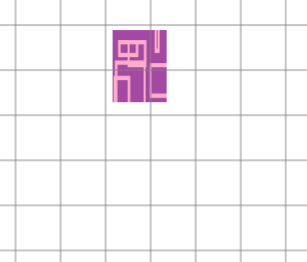
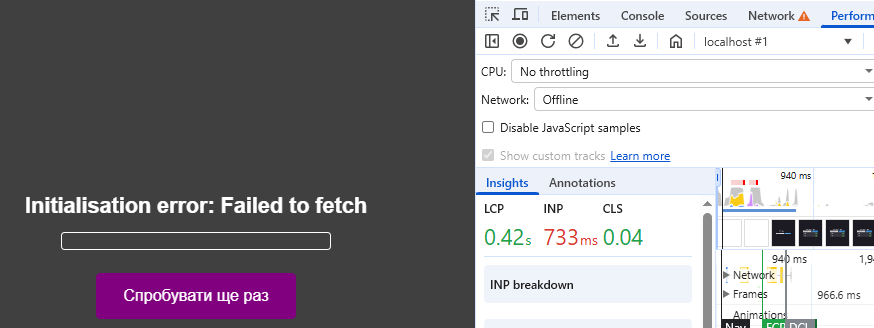
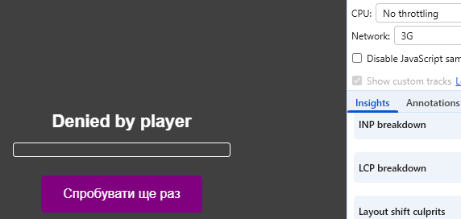
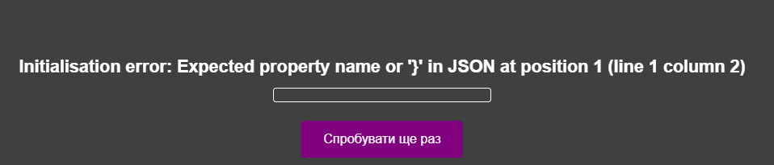

## Five microtask/task ordering puzzles

### 1) 
```
async function puzzle1() {
    console.log("1");

    await new Promise((resolve) => {
        setTimeout(() => { 
            console.log("5");
            resolve();
        }, 1000);
        console.log("2");
    });

    setTimeout(() => { console.log("6"); }, 1000);
    console.log("3");
}

puzzle1();
console.log("4");
```

**answer** = 1, 2, 4, 5, 3, 6

**clarification** - synchronous code executes first (1, 2, 4), then the timer macro-task triggers and logs 5, and then, as a part of second microtask queue, the remaining part of the function logs 3 (as a microtask), and the final macro-task logs 6

### 2)
```
new Promise((resolve) => {
setTimeout(() => {
    console.log("1"); }, 1000);
    resolve(2);
})
.then((val) => {console.log(val);});

console.log("3");
```

**answer** = 3, 2, 1

**clarification** - synchronous code executes first (3), then the microtask from .then() executes and logs 2 and the final macro-task timer logs 1

### 3) 
```
Promise.resolve()
.then(() => {
    console.log("1");
    setTimeout(() => { console.log("2"); }, 0);
})
.then(() => {
    console.log("3");
});

console.log("4");
```

**answer** = 4, 1, 3, 2

**clarification** - synchronous code executes first (4), then the microtasks chain executes and logs 1 and 3, and finally the zero-delay macro-task logs 2

### 4)
```
setTimeout(() => {
console.log("1");
requestAnimationFrame(() => { console.log("3");});
Promise.resolve().then(() => { console.log("2"); }); }, 0);

Promise.resolve().then(() => { console.log("4"); });
console.log("5");
```

**answer** = 5, 4, 1, 2, 3

**clarification** - synchronous code executes first (5), then the microtask logs 4, followed by the macro-task logging 1, then the inner microtask queue flushes and logs 2, and finally requestAnimationFrame executes during the render step and logs 3

### 5) 
```
Promise.all([
Promise.resolve().then(() => { console.log("1"); }),
Promise.resolve().then(() => {
    console.log("2");
    throw new Error("3");
}),
Promise.resolve().then(() => { console.log("4"); }),
])
.then((results) => { console.log("5", results); })
.catch((err) => { console.log(err.message); })
.finally(() => { console.log("6"); });
```

**answer** = 1, 2, 4, 3, 6

**clarification** - Promise.all executes all three promise microtasks (1, 2, 4) regardless of the result, but the thrown error triggers the .catch() block which logs 3, the success .then() block is skipped due to the rejection, and the final .finally() block logs 6

## Failure Gallery
### 1. 

### 2. 

### 3. 

### 4. 
